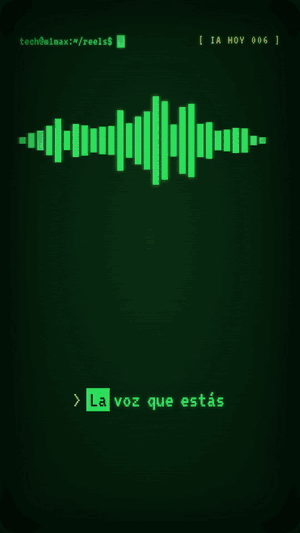

# reels-ia-local 🎬

**Pídele a Claude un video y te lo entrega listo para publicar: con tu voz clonada, subtítulos palabra por palabra y animaciones. Todo corre en tu computadora: sin pagar créditos, sin subir tu voz a la nube.**

<p align="center">
  
  <br>
  <sub>Reel de ejemplo (<a href="examples/006-ia-local">examples/006-ia-local</a>): voz clonada, subtítulos y animación, generados en una MacBook.</sub>
</p>

```
"Hazme un reel sobre qué es una API, con tema pizarra"
        │
        ▼
 guion.txt ──► tu voz clonada ──► subtítulos ──► escenas animadas ──► reel 9:16 + YouTube 16:9
              (Qwen3-TTS)        (Whisper)      (HyperFrames + GSAP)    + textos para publicar
```

De un tema salen:

- `NNN-tema-reel-9x16.mp4` para Shorts, TikTok, Reels de Instagram y Facebook
- `NNN-tema-youtube-16x9.mp4` para YouTube
- `publicacion.md` con título, descripción, tags y el texto con hashtags de cada red

Funciona en **Mac, Windows y Linux**. Elige solo el motor que tu computadora aguanta.

---

## ¿Mi computadora aguanta?

| Tu equipo | Voz | Velocidad |
|---|---|---|
| Mac con chip Apple (M1–M4), 16 GB+ | Tu voz clonada, mejor calidad (Qwen3-TTS 1.7B) | ⚡ Rápida |
| Mac con chip Apple, 8 GB | Tu voz clonada (0.6B) | ⚡ Rápida |
| PC con NVIDIA 8 GB+ VRAM | Tu voz clonada, mejor calidad (1.7B) | ⚡ Rápida |
| PC con NVIDIA 4–8 GB | Tu voz clonada (0.6B) | ⚡ Rápida |
| PC sin NVIDIA, 16 GB+ RAM | Tu voz clonada (0.6B) | 🐢 Lenta (varios min por min de video) |
| PC sin NVIDIA, menos de 16 GB | Voz genérica en español (Kokoro) | ⚡ Rápida |

Para saberlo exacto antes de instalar nada, el instalador corre un diagnóstico (`voice/doctor.py`) que revisa CPU, RAM, GPU, disco y herramientas. Necesitas entre **6 y 12 GB libres**.

## Instalación

Necesitas [Claude Code](https://claude.com/claude-code) (o cualquier agente que lea skills / `AGENTS.md`).

```bash
git clone https://github.com/Estuardo-Sazo/reels-ia-local.git
cd reels-ia-local
```

**Mac / Linux**

```bash
./install.sh
```

En Mac necesitas [Homebrew](https://brew.sh). En Linux usa `apt` (Ubuntu/Debian) y pide tu contraseña para ffmpeg y PortAudio.

**Windows 10/11** (PowerShell)

```powershell
powershell -ExecutionPolicy Bypass -File install.ps1
```

Usa `winget` para instalar Git, FFmpeg, Node y uv.

El instalador pone todo lo necesario (Python 3.12 con [uv](https://docs.astral.sh/uv/), Node 22+, ffmpeg, los modelos y el Chrome que renderiza) y se puede correr de nuevo sin problema. ¿Prefieres que lo haga Claude? Abre `claude` en la carpeta y dile **"instala el proyecto"**.

## Graba tu voz (una vez)

```bash
cd voice
uv run grabar.py yo
```

Lee en voz alta el texto que aparece (~15 s), con el tono que quieres en tus videos. También puedes importar una nota de voz: `uv run grabar.py yo --from nota.m4a`. Pruébala con `uv run probar.py yo`.

## Pide tu video

```bash
claude
```

Y escribe, por ejemplo:

- *"Hazme un video de 60 segundos sobre cómo funciona HTTPS, tema blueprint"*
- *"Convierte este guion en reel: …"*
- *"La frase 4 suena robótica, regenérala"*
- *"Cambia la escena 2 para que muestre un diagrama"*
- *"Escribe los textos para publicar del episodio 003"*
- *"Usa las fotos de `recursos/` y este clip de mi app en la escena 3"*
- *"Ya grabé `recursos/clase.mp4`: sácame tres reels de los mejores momentos"*

Claude escribe el guion, te lo muestra, genera la voz, sincroniza subtítulos, diseña las escenas, revisa los cuadros y renderiza los dos videos en `episodes/NNN-tema/out/`.

## Tus fotos, clips y videos

Pon tus archivos en [`recursos/`](recursos/) (no se suben a git) y pídeselos a Claude:

- **Fotos y capturas** dentro de las escenas.
- **Clips de video** en una ventana del escenario o de fondo a pantalla completa, sincronizados con una palabra de la voz.
- **Música** de fondo, recortada y con volumen bajo.
- **Tu propia grabación:** si ya grabaste un video (a cámara, una clase, una partida), Claude lo transcribe, te propone los mejores tramos y saca de ahí los reels con **tu voz real**, subtítulos y animaciones encima. No hace falta clonar la voz para esto.

```bash
cd voice
uv run video.py transcribir ../recursos/mi-video.mp4                     # frases con su segundo
uv run video.py extraer ../recursos/mi-video.mp4 ../studio/assets/ep010 --de 95 --a 150
cd ../studio && node tools/build-data.mjs assets/ep010 && node tools/medios.mjs ep010
```

Detalles en [`references/medios.md`](.claude/skills/reels-video/references/medios.md).

## Skills incluidas

| Skill | Para qué |
|---|---|
| [`reels-instalar`](.claude/skills/reels-instalar/SKILL.md) | Diagnóstico de hardware, instalación y solución de problemas |
| [`reels-voz`](.claude/skills/reels-voz/SKILL.md) | Grabar, importar, probar y arreglar tu voz clonada |
| [`reels-video`](.claude/skills/reels-video/SKILL.md) | Del tema al MP4: guion, voz, subtítulos, escenas, render y textos para publicar |

Están en `.claude/skills/`, así que Claude Code las carga al abrir la carpeta. Otros agentes (Codex, Cursor, Gemini CLI…) pueden seguir [`AGENTS.md`](AGENTS.md).

## Temas visuales

| `papel` | `blueprint` | `editorial` | `terminal` | `documental` | `pizarra` | `isometrico` |
|---|---|---|---|---|---|---|
| Stop motion, recortes y glitch | HUD futurista | Revista suiza | Monitor CRT verde | Sobrio, cámara continua | Tiza en pizarrón | Bloques 3D |

Cada uno tiene un episodio de ejemplo completo en [`examples/`](examples/) (guion + escenas + textos). Pídele a Claude un tema nuevo y lo agrega al motor.

## Hazlo a mano (sin agente)

```bash
cd voice
uv run tts.py ../episodes/001-tema/guion.txt ../studio/assets/ep001
uv run captions.py ../studio/assets/ep001/voz.wav ../studio/assets/ep001/captions.json ../episodes/001-tema/guion.txt
cd ../studio
node tools/build-data.mjs assets/ep001
cp ../examples/006-ia-local/scenes.js assets/ep001/   # y adáptalo
node tools/render.mjs ep001 ../episodes/001-tema
```

En el guion, `SQL{ese cu ele}` hace que la voz lea "ese cu ele" y el subtítulo muestre "SQL". Para varias palabras: `[Stack Overflow]{stac overflou}`.

## Estructura

```
install.sh · install.ps1     instaladores
reels.config.json            motor y modelos elegidos para tu equipo (lo crea el instalador)
voice/                       Python: voz, subtítulos, grabación, diagnóstico
  doctor.py                  ¿qué aguanta tu equipo?
  motor.py                   misma API sobre MLX (Mac) o PyTorch (CUDA / CPU)
  tts.py · captions.py       guion → voz.wav + segments.json → captions.json
  grabar.py · probar.py      tu voz de referencia
  tomas.py                   varias tomas de una frase para elegir de oído
  video.py                   reels desde tu propia grabación (transcribir / extraer)
studio/                      HyperFrames: composición 9:16 (index.html) y 16:9 (compositions/youtube.html)
  assets/reel.js · reel.css  motor de escenas, temas y subtítulos
  assets/epNNN/              audio, tiempos y scenes.js de cada episodio
  tools/                     build-data, use-episode, medios, render
  assets/epNNN/media/        fotos y clips del episodio (medios.json)
episodes/NNN-tema/           guion.txt, publicacion.md y out/ con los MP4
examples/                    un episodio de ejemplo por tema
assets/voces/                tu voz de referencia (nunca se sube a git)
recursos/                    tus fotos, videos y música (nunca se suben a git)
```

## Créditos y licencias

Código de este repo: [MIT](LICENSE). Se apoya en:

- [Qwen3-TTS](https://github.com/QwenLM/Qwen3-TTS) (Apache 2.0) — clonación de voz
- [Whisper](https://github.com/openai/whisper) (MIT) y [mlx-whisper](https://github.com/ml-explore/mlx-examples) — subtítulos
- [mlx-audio](https://github.com/Blaizzy/mlx-audio) (MIT) — voz en Mac
- [Kokoro-82M](https://huggingface.co/hexgrad/Kokoro-82M) (Apache 2.0) — voz genérica
- [HyperFrames](https://hyperframes.heygen.com) (Apache 2.0) — render de HTML a MP4
- [GSAP](https://gsap.com) — animación (licencia gratuita de GSAP)

**Uso responsable:** clona solo tu voz o la de alguien que te dé permiso, y no publiques audio que se haga pasar por otra persona.
